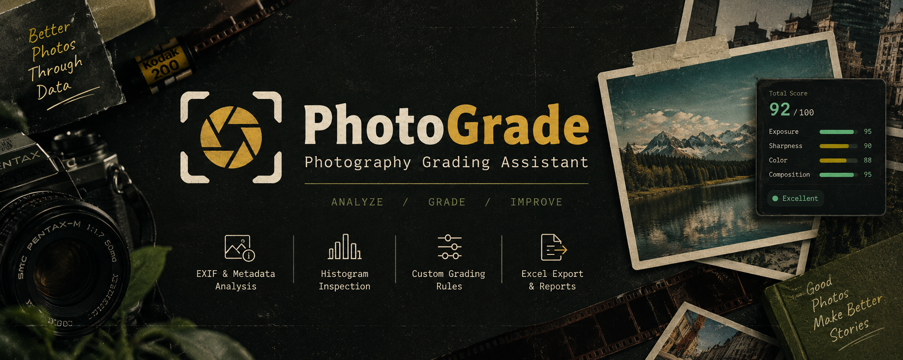
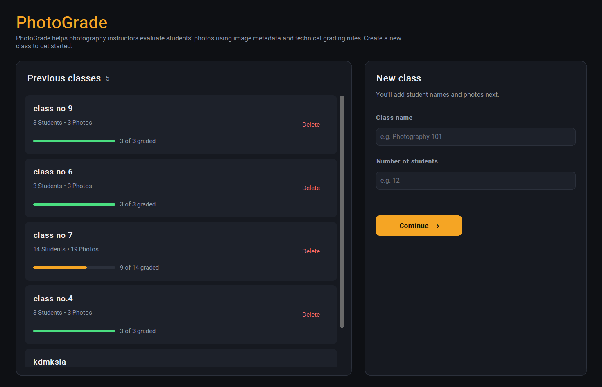
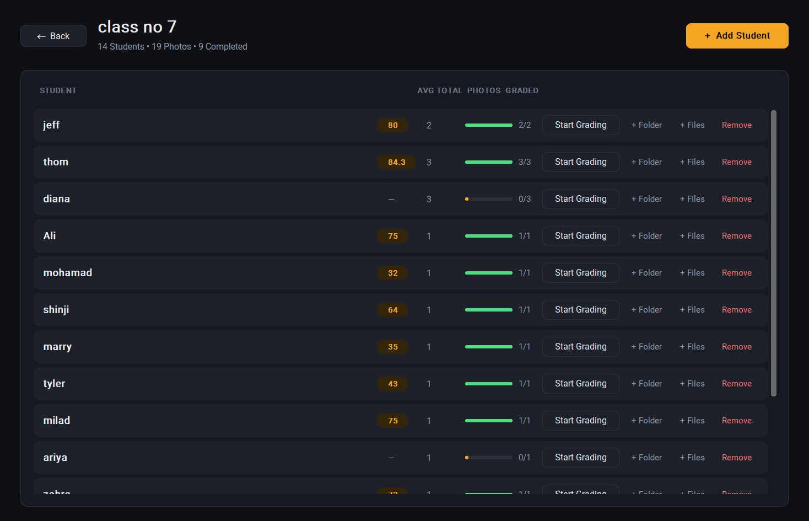
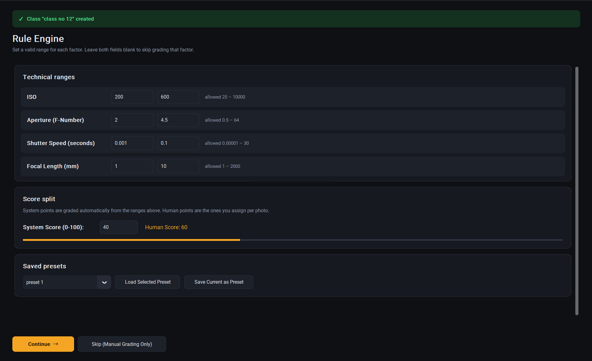
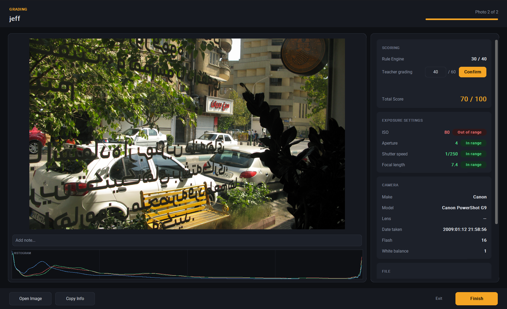
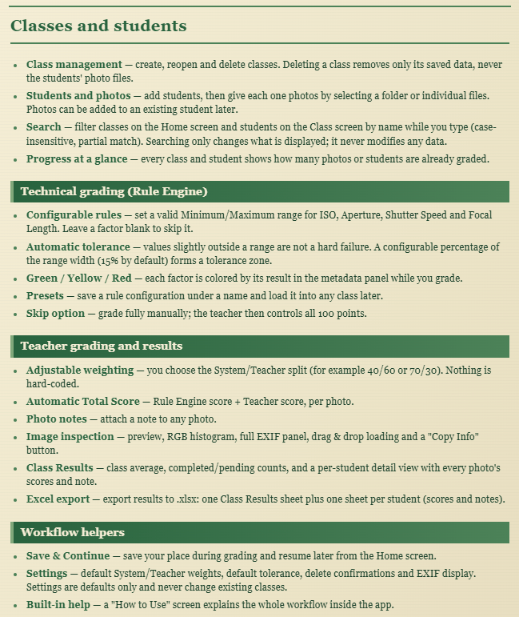

<p align="center">
  
</p>

<p align="center">
  <strong>Turn photo metadata into consistent, transparent, teacher-guided grades.</strong>
</p>

<p align="center">
  <strong>Version v1.1.1</strong>
</p>

<p align="center">
  <a href="https://github.com/vafabara/Photograde/releases/latest">
    <strong>⬇️ Download PhotoGrade Installer</strong>
  </a>
  <br>
  <sub>Download the Windows installer from the latest release.</sub>
</p>

# 📷 PhotoGrade

PhotoGrade is a local-first Python desktop app that helps photography teachers grade student photos. It reads each photo's EXIF metadata, checks it against technical rules the teacher defines, and combines that automatic score with the teacher's own evaluation into a final grade.

Everything runs on your machine: no accounts, no cloud, no database. Classes, notes and scores are stored as plain JSON files.

## 📸 Screenshots

<div align="center">
  <p>
    
    
  </p>
  <p>
    
    
  </p>
</div>

## ✨ Features
<p align="center">
  
</p>

## 🧮 How grading works

1. The teacher's **System Score** (out of 100) is split **evenly** across the active rules. With a 40-point System Score and 4 rules, each rule is worth 10 points.
2. Each rule is evaluated against the photo's EXIF value:

| Result | Condition | Deduction |
| --- | --- | --- |
| 🟢 Green | Value is inside the Minimum–Maximum range | none |
| 🟡 Yellow | Value is outside the range but inside the tolerance zone | half of the rule's points |
| 🔴 Red | Value is beyond the tolerance zone | all of the rule's points |
| ⚪ Missing | The photo has no value for that factor | none (benefit of the doubt) |

3. **Rule Engine score** = System Score − deductions, rounded to one decimal.
4. **Total Score** = Rule Engine score + Teacher score (the Teacher score cannot exceed the Teacher maximum, which is `100 − System Score`).
5. **Student average** = mean of that student's photo Total Scores. A student's average is only shown once every photo is graded.
6. **Class average** = mean of *all graded photos* in the class, not the mean of the student averages, so a student with 10 photos counts for more than a student with 2.

Tolerance is proportional to each rule's own range: an ISO range of 200–600 and an aperture range of f/4–f/8 each get a tolerance sized to their own width.

## 🚦 Typical workflow

1. **Home → New class** — enter a class name and number of students.
2. Enter each student's name, then select their photos (folder or files).
3. **Configure the Rule Engine** (or load a preset, or skip it).
4. **Grade** photo by photo: review metadata and histogram, enter the Teacher score, confirm, optionally add a note.
5. Review **Class Results**, open any student's details, and **export to Excel**.
6. Reopen the class any time from **Previous classes** to add students or photos, or to grade a single student.

Photo limits per student: up to **20 images** and **100 MB** in total. Supported formats: `.jpg`, `.jpeg`, `.png`, `.webp`, `.bmp`, `.tiff`.

## ▶️ Getting started

**Requirements:** Python 3.10 or newer (CI runs on 3.12).

```bash
git clone https://github.com/vafabara/Photograde.git
cd Photograde
pip install -r requirements.txt
python main.py
```

## 🧪 Tests

```bash
python -m pytest tests/ -v
```

The suite covers the Rule Engine and tolerance, teacher scoring, converters, metadata and histograms, class and preset storage, grading-session storage, the student DataFrame and Excel export. A GitHub Actions workflow runs it on every push and pull request.

## 🏗️ Project structure

```text
Photograde/
├── .github/workflows/tests.yml   # CI: runs pytest on push / pull request
├── app/
│   ├── core/                     # Logic only, no GUI imports
│   │   ├── class_model.py        #   persisted Class / Student / Photo records
│   │   ├── student.py            #   live review state (ImageRecord)
│   │   ├── rules.py              #   factors, Rule, RuleEngineConfig, validation
│   │   ├── tolerance.py          #   automatic tolerance zone
│   │   ├── scoring.py            #   Green / Yellow / Red + Technical Score
│   │   ├── teacher_scoring.py    #   teacher score validation + Total Score
│   │   ├── student_dataframe.py  #   per-student and per-class pandas tables
│   │   ├── image.py              #   image loading, folder/file validation
│   │   ├── metadata.py           #   EXIF extraction (piexif)
│   │   ├── converters.py         #   EXIF value conversion and formatting
│   │   └── histogram.py          #   RGB histogram data
│   │
│   ├── gui/                      # CustomTkinter screens
│   │   ├── app.py                #   App controller: navigation + persistence
│   │   ├── theme.py              #   design system: colors, fonts, shared widgets
│   │   ├── widgets.py            #   dialogs (confirm, error, info, note, prompt)
│   │   ├── home_screen.py        #   previous classes, search, new class
│   │   ├── class_screen.py       #   students, search, add photos / students
│   │   ├── student_setup.py      #   photo selection during class creation
│   │   ├── rule_engine.py        #   rule ranges, score split, presets
│   │   ├── image_viewer.py       #   preview, histogram, note bar
│   │   ├── metadata_panel.py     #   file + EXIF info with rule colors
│   │   ├── teacher_grading.py    #   Rule Engine / Teacher / Total panel
│   │   ├── results_screen.py     #   class results + Excel export button
│   │   ├── student_detail.py     #   per-photo score table (from Class screen)
│   │   ├── student_results_detail.py  # per-photo scores and notes (from Results)
│   │   ├── settings_screen.py    #   app defaults and preferences
│   │   └── help.py               #   built-in "How to Use" screen
│   │
│   └── storage/                  # Persistence and export, no GUI code
│       ├── class_storage.py      #   classes/<id>/class.json
│       ├── rule_presets.py       #   saved Rule Engine presets
│       ├── settings_storage.py   #   app settings
│       ├── grading_session.py    #   Save & Continue checkpoint
│       └── export.py             #   Excel workbook export
│
├── assets/images/                # README screenshots
├── tests/                        # pytest suite
├── main.py                       # entry point
└── requirements.txt
```

### Architecture

The app is split into three layers with one rule between them: **`core/` never imports the GUI.**

- **`core/`** holds the data models and every calculation (tolerance, status, scores, averages), so it can be tested without opening a window.
- **`gui/`** renders data and reports user actions through callbacks. Screens never touch storage; they call back into `App` (the controller), which saves and then re-renders from what is on disk. All colors and shared widget styles live in `theme.py`, so a visual change is made in one place.
- **`storage/`** reads and writes plain JSON and builds the Excel export, with no GUI code.

Scores are calculated once, in `core`, and stored per photo. Every screen (class list, results, details, export) reads those same stored values rather than recalculating them.

A confirmed score or note is written to `class.json` immediately. The grading checkpoint only remembers *where you stopped*, and only one can exist at a time. Deleting a class from the app removes its `classes/<id>/` folder only; the original photo folders are never touched.

## 🧰 Built with

| Purpose | Library |
| --- | --- |
| GUI | CustomTkinter, tkinterdnd2 (drag & drop) |
| Images | Pillow |
| EXIF | piexif |
| Data tables / export | pandas, openpyxl |
| Testing | pytest |

## 🚀 Roadmap

PhotoGrade is evolving toward a local-first, privacy-friendly grading assistant. Planned directions include more advanced student-level statistics, richer grading reports, and optional AI-assisted photography evaluation.
